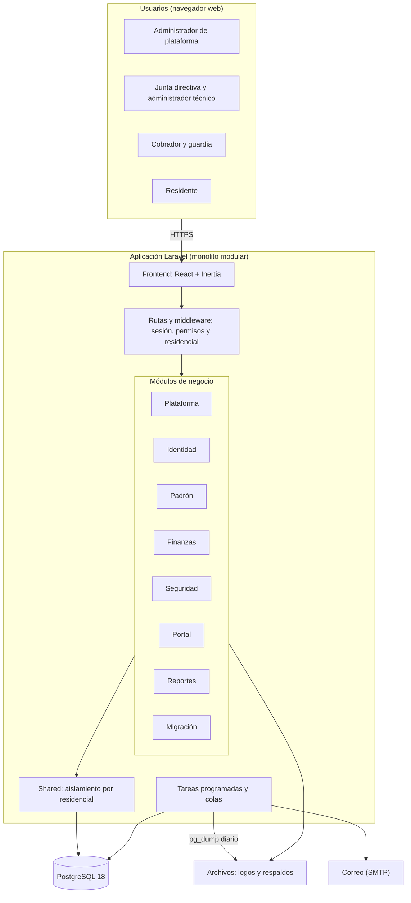

# Arquitectura y stack tecnológico

Sistema Integral de Gestión Digital del Patronato. Es una sola aplicación que atiende a varios residenciales, con los datos de cada uno aislados de los demás.

## Estilo de arquitectura

**Monolito modular.** Todo se despliega como una sola aplicación Laravel, pero el código de negocio está separado por módulos en `web/src/Modules`.

Se eligió porque el equipo es pequeño y las operaciones de cobros, residentes y vigilancia comparten datos y transacciones. Separar en microservicios agregaría costo de operación sin un beneficio claro para este tamaño de sistema.

## Diagrama de arquitectura

### Cómo viaja una petición

1. El navegador pide una página y Laravel revisa la sesión, el permiso y el residencial del usuario.
2. El controlador del módulo usa sus servicios y modelos. Las consultas se filtran solas por `residencial_id`.
3. Laravel responde con una página Inertia, y React la muestra sin necesidad de una API aparte.

## Módulos

| Módulo | Responsabilidad | Estado |
|---|---|---|
| Plataforma | Residenciales y respaldos | Implementado |
| Identidad | Cuentas, roles, permisos y auditoría | Implementado |
| Padrón | Viviendas y residentes | Implementado |
| Finanzas | Tarifas, cobros, pagos y egresos | Parcial: solo tarifas |
| Seguridad | Visitas, incidencias y vehículos | Solo esquema de base de datos |
| Portal | Vista del residente | Pendiente |
| Reportes | Reportes financieros y operativos | Pendiente |
| Migración | Carga del histórico en TXT | Pendiente |

## Stack tecnológico

Versiones instaladas actualmente, tomadas de `composer.lock` y `package-lock.json`.

| Capa | Tecnología | Versión | Para qué se usa |
|---|---|---|---|
| Backend | PHP | 8.4 | Lenguaje del servidor |
| Backend | Laravel | 13.39 | Framework de la aplicación |
| Autenticación | Laravel Fortify | 1.41 | Login y recuperación de contraseña |
| Puente | Inertia | 3 | Une Laravel y React sin API aparte |
| Puente | Laravel Wayfinder | 0.1 | Genera rutas tipadas para TypeScript |
| Frontend | React | 19.3 | Interfaz de usuario |
| Frontend | TypeScript | 5.9 | Tipado del frontend |
| Frontend | Tailwind CSS | 4.3 | Estilos |
| Compilación | Vite+ | 1.4 | Compilación, formato y lint del frontend |
| Base de datos | PostgreSQL | 18 | Datos de la aplicación |
| Pruebas | Pest | 5.3 | Pruebas automatizadas, en SQLite en memoria |
| Calidad | Larastan (PHPStan) | 3.13 | Análisis estático de PHP |
| Calidad | Laravel Pint | 1.32 | Estilo de código PHP |
| Respaldos | pg_dump y pg_restore | 18 | Respaldo diario y restauración |
| Repositorio y CI/CD | GitHub y GitHub Actions | | Código y pipeline |

## Decisiones principales

| Decisión | Motivo |
|---|---|
| Laravel en lugar de Express | Trae integrados autenticación, colas, tareas programadas y migraciones |
| PostgreSQL en lugar de MySQL | Da restricciones más fuertes, como la extensión `btree_gist` usada por el módulo Seguridad, y respaldos con `pg_dump` |
| Una base de datos compartida con `residencial_id` | Un solo despliegue atiende a todos los residenciales. El trait `PerteneceAResidencial` filtra las consultas y rechaza con 403 el acceso a datos de otro residencial |
| Inertia en lugar de una API REST | Evita mantener una API y un cliente por separado |

## Infraestructura

| Elemento | Hoy, en desarrollo | Propuesta para producción |
|---|---|---|
| Aplicación | `composer dev` en Windows | Servidor Linux con Nginx y PHP-FPM, con HTTPS |
| Base de datos | PostgreSQL local | PostgreSQL 18 en el servidor o administrado |
| Tareas programadas | Programador de tareas de Windows | `cron` ejecutando `schedule:run` cada minuto |
| Colas | Driver `database` | Driver `database` con un proceso `queue:work` permanente |
| Correo | Modo `log`, sin envío real | Proveedor SMTP |
| Respaldos | Disco local | Copia adicional fuera del servidor |

El proveedor de hosting y el servicio SMTP aún no están definidos.

El pipeline se describe en [pipeline-ci-cd.md](pipeline-ci-cd.md).
