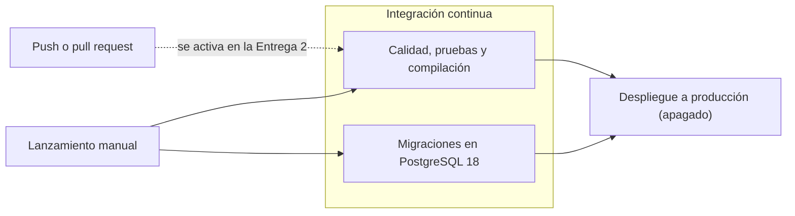

# Pipeline CI/CD

El pipeline está definido en [`.github/workflows/ci-cd.yml`](../.github/workflows/ci-cd.yml), con GitHub Actions.

**Estado actual: definido, no activo.** No corre con `push` ni con `pull_request`. Solo puede lanzarse a mano desde la pestaña Actions, y el despliegue está apagado. Debe quedar funcional en la Entrega 2.

## Flujo



## Etapas

| Trabajo | Paso | Comando | Si falla, significa que |
|---|---|---|---|
| Calidad, pruebas y compilación | Dependencias | `composer install`, `npm ci` | Las dependencias no se pueden instalar |
| | Compilación | `npm run build` | El frontend no compila |
| | Estilo PHP | `vendor/bin/pint --test` | El código PHP no cumple el formato |
| | Análisis PHP | `vendor/bin/phpstan analyse` | Hay errores de tipos en PHP |
| | Frontend | `npm run check` | Hay errores de formato o lint |
| | Tipos | `npm run types:check` | Hay errores de TypeScript |
| | Pruebas | `php artisan test` | Se rompió un comportamiento esperado |
| Migraciones en PostgreSQL | Migraciones | `php artisan migrate --force` | El esquema no se aplica en PostgreSQL |
| Despliegue a producción | Pendiente | | Aún sin implementar |

El trabajo de migraciones existe porque las pruebas corren en SQLite y producción usa PostgreSQL.

## Qué falta para la Entrega 2

1. **Activar la integración continua.** Reemplazar el bloque `on` del archivo por:

   ```yaml
   on:
     workflow_dispatch:
     push:
       branches:
         - main
     pull_request:
   ```

2. **Proteger `main`.** En GitHub, exigir que el pipeline pase antes de unir cambios.
3. **Definir el servidor de producción** y guardar sus credenciales en los secretos de GitHub.
4. **Implementar el despliegue.** Quitar `if: ${{ false }}` del trabajo `desplegar` y reemplazar su paso por la publicación real. Debe subir el código y el frontend compilado, y luego ejecutar `php artisan migrate --force` en el servidor.
