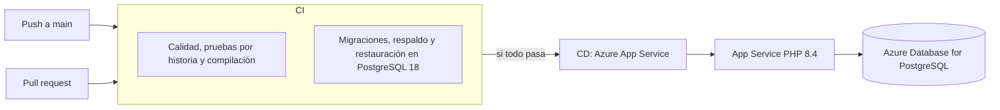

# Pipeline CI/CD

El pipeline usa GitHub Actions y está dividido en dos archivos:

| Archivo | Qué hace | Cuándo corre |
|---|---|---|
| [`ci.yml`](../.github/workflows/ci.yml) | Integración continua: calidad, pruebas por historia de usuario, migraciones, respaldo y restauración | En cada `push` a `main`, en cada pull request y a mano |
| [`cd.yml`](../.github/workflows/cd.yml) | Entrega continua: publica la versión en Azure App Service | Cuando CI termina bien después de un `push` a `main`, o a mano |

## Flujo



Un pull request solo corre CI. El despliegue ocurre únicamente con cambios que ya están en `main`.

## CI

| Trabajo | Paso | Comando | Si falla, significa que |
|---|---|---|---|
| Calidad, pruebas y compilación | Dependencias | `composer install`, `npm ci` | Las dependencias no se pueden instalar |
| | Compilación | `npm run build` | El frontend no compila |
| | Estilo PHP | `vendor/bin/pint --test` | El código PHP no cumple el formato |
| | Análisis PHP | `vendor/bin/phpstan analyse` | Hay errores de tipos en PHP |
| | Frontend | `npm run check` | Hay errores de formato o lint |
| | Tipos | `npm run types:check` | Hay errores de TypeScript |
| | Pruebas por historia | `php artisan test <archivos de la historia>` | Esa historia de usuario dejó de cumplir sus criterios |
| Migraciones, respaldo y restauración | Migraciones | `php artisan migrate --force` | El esquema no se aplica en PostgreSQL |
| | Respaldo | `php artisan respaldos:crear` | `pg_dump` no puede respaldar la base |
| | Restauración | `php artisan respaldos:restaurar` en una base nueva | El respaldo no se puede recuperar |
| | Comparación | Cuenta tablas y roles en ambas bases | La base restaurada no quedó igual a la original |

El segundo trabajo existe porque las pruebas corren en SQLite y producción usa PostgreSQL. También cumple el criterio de HU-09 de probar la restauración en un ambiente de pruebas.

### Pruebas por historia de usuario

Cada historia terminada tiene su propio paso en CI, así GitHub muestra cuál pasa y cuál falla. Los pasos corren aunque falle uno anterior.

| Paso | Archivos de prueba | Pruebas |
|---|---|---|
| HU-01 · Registrar un residencial | `Plataforma/RegistrarResidencialTest` | 12 |
| HU-02 · Aislar la información de cada residencial | `Identidad/AislamientoResidencialTest` | 19 |
| HU-03 · Suspender o reactivar un residencial | `Plataforma/SuspenderResidencialTest` | 10 |
| HU-04 · Iniciar sesión | `Identidad/AccesoTest`, `Auth/AuthenticationTest`, `ExampleTest` | 19 |
| HU-05 · Recuperar la contraseña | `Identidad/RecuperarPasswordTest`, `Auth/PasswordResetTest` | 12 |
| HU-06 · Administrar cuentas de usuario | `Identidad/CuentasTest`, `Identidad/PasswordTemporalTest` | 28 |
| HU-07 · Configurar permisos por rol | `Identidad/PermisosTest` | 15 |
| HU-08 · Consultar la bitácora de auditoría | `Identidad/BitacoraTest` | 17 |
| HU-09 · Respaldar y restaurar la base de datos | `Plataforma/RespaldosTest` | 7 |
| HU-10 · Registrar viviendas | `Padron/ViviendasTest`, `Padron/ViviendasInactivasTest` | 21 |
| HU-11 · Registrar residentes | `Padron/ResidentesTest` | 13 |
| HU-12 · Buscar vecinos y viviendas | Pruebas de búsqueda de `Padron` (`--filter=search`) | 6 |
| Base del sistema | `Unit`, `Settings`, `DashboardTest` y el resto de `Auth` | 28 |

Los archivos están en `presentacion/tests/Feature`. Las pruebas de HU-12 también forman parte de HU-10. Sin contarlas dos veces, los pasos suman las 201 pruebas del proyecto.

Al agregar una historia nueva, crea su archivo de prueba y agrega su paso en `ci.yml`.

## CD

1. Descarga la versión que pasó CI.
2. Instala las dependencias de producción y compila el frontend.
3. Empaqueta en un `.zip` las cuatro capas (`presentacion`, `negocio`, `persistencia` y `base-de-datos`) y la carpeta `scripts`, sin `node_modules`, `tests` ni `.env`.
4. Publica el `.zip` en App Service con el *publish profile* guardado como secreto, y el sitio se reinicia.
5. Al arrancar, App Service ejecuta [`scripts/azure/inicio.sh`](../scripts/azure/inicio.sh), que:
   - configura Nginx con [`nginx.conf`](../scripts/azure/nginx.conf) para servir la carpeta `presentacion/public`;
   - enlaza `storage` a `/home/patronato/storage`, que se conserva entre despliegues, así no se pierden los logos;
   - aplica las migraciones, carga los roles y prepara la caché de Laravel.
6. Consulta `/up` hasta que el sitio responde. Si no responde en 5 minutos, el despliegue falla.

### Recursos en Azure

| Recurso | Plan | Uso |
|---|---|---|
| App Service (Linux, PHP 8.4) | B1 | Aplicación web |
| Azure Database for PostgreSQL, servidor flexible | Burstable B1ms, 32 GB | Base de datos |

La configuración de producción (`APP_KEY`, datos de la base, `APP_URL`) vive en la **configuración de la aplicación** de App Service, no en un archivo `.env`.

## Puesta en marcha

Se hace una sola vez.

1. En [Azure Cloud Shell](https://shell.azure.com), modo Bash, sube el script [`scripts/azure/crear-recursos.sh`](../scripts/azure/crear-recursos.sh) y ejecútalo con nombres únicos:

   ```bash
   APP=patronato-tuapellido BD=patronato-bd-tuapellido bash crear-recursos.sh
   ```

   Crea el grupo de recursos, PostgreSQL con la base `patronato` y el App Service, y descarga el *publish profile* en `publish-profile-<APP>.xml`. Al final muestra los valores para GitHub y la contraseña de PostgreSQL. **Guarda esa contraseña**: no se vuelve a mostrar.

   Variables opcionales: `REGION` (por omisión `eastus2`), `SKU` (`B1`) y `VERSION_PG` (`17`).

2. En GitHub, **Settings > Environments**, crea el ambiente `produccion` y agrega:

   | Tipo | Nombre | Valor |
   |---|---|---|
   | Secreto | `AZURE_WEBAPP_PUBLISH_PROFILE` | Todo el contenido de `publish-profile-<APP>.xml` |
   | Variable | `AZURE_WEBAPP_NAME` | El valor de `APP` |
   | Variable | `AZURE_WEBAPP_HOST` | El dominio del sitio que muestra el script, sin `https://` |

   Después borra el archivo `.xml`: da acceso para publicar en el sitio.

3. En **Actions > CD > Run workflow**, lanza el primer despliegue.

4. Crea el primer administrador de la plataforma: regístrate en `https://<AZURE_WEBAPP_HOST>/register` y luego, desde **App Service > SSH**, ejecuta:

   ```bash
   cd /home/site/wwwroot && php artisan plataforma:admin tu-correo@ejemplo.com
   ```

En **Settings > Branches**, protege `main` y exige que pasen los dos trabajos de CI antes de unir cambios.

## Diferencias con un servidor propio

- **Respaldos (HU-09).** App Service no tiene `cron` ni `pg_dump`, así que el comando `respaldos:crear` no corre en Azure. Los respaldos los hace Azure Database for PostgreSQL: uno diario automático, con 7 días de retención y restauración a un momento exacto. La retención se puede subir hasta 35 días.
- **Colas.** Se usa `QUEUE_CONNECTION=sync`: las tareas se ejecutan en el momento, sin un proceso aparte.
- **Registro.** Los errores salen por `stderr`; se ven en **App Service > Log stream**.
- **Varias instancias.** Si el plan se escala a más de una instancia, cada una aplica las migraciones al arrancar. Para eso conviene pasar las migraciones a un paso propio del CD.
