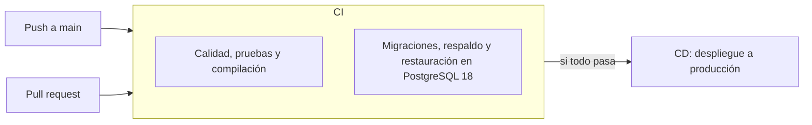

# Pipeline CI/CD

El pipeline usa GitHub Actions y está dividido en dos archivos:

| Archivo | Qué hace | Cuándo corre |
|---|---|---|
| [`ci.yml`](../.github/workflows/ci.yml) | Integración continua: calidad, pruebas, migraciones, respaldo y restauración | En cada `push` a `main`, en cada pull request y a mano |
| [`cd.yml`](../.github/workflows/cd.yml) | Entrega continua: publica la versión en el servidor de producción | Cuando CI termina bien después de un `push` a `main`, o a mano |

## Flujo

Un pull request solo corre CI. El despliegue ocurre únicamente con cambios que ya están en `main`.

## CI

| Trabajo | Paso | Comando | Si falla, significa que |
|---|---|---|---|
| Calidad, pruebas y compilación | Dependencias | `composer install`, `npm ci` | Las dependencias no se pueden instalar |
| | Compilación | `npm run build` | El frontend no compila |
| | Estilo PHP | `vendor/bin/pint --test` | El código PHP no cumple el formato |
| | Análisis PHP | `vendor/bin/phpstan analyse` | Hay errores de tipos en PHP |
| | Frontend | `npm run check` | Hay errores de formato o lint |
| | Tipos | `npm run types:check` | Hay errores de TypeScript |
| | Pruebas | `php artisan test` | Se rompió un comportamiento esperado |
| Migraciones, respaldo y restauración | Migraciones | `php artisan migrate --force` | El esquema no se aplica en PostgreSQL |
| | Respaldo | `php artisan respaldos:crear` | `pg_dump` no puede respaldar la base |
| | Restauración | `php artisan respaldos:restaurar` en una base nueva | El respaldo no se puede recuperar |
| | Comparación | Cuenta tablas y roles en ambas bases | La base restaurada no quedó igual a la original |

El segundo trabajo existe porque las pruebas corren en SQLite y producción usa PostgreSQL. También cumple el criterio de HU-09 de probar la restauración en un ambiente de pruebas.

## CD

1. Descarga la versión que pasó CI.
2. Instala las dependencias de producción y compila el frontend.
3. Empaqueta la carpeta `web`, sin `node_modules`, `storage`, `tests` ni `.env`.
4. La copia al servidor por SSH y ejecuta [`web/scripts/desplegar.sh`](../web/scripts/desplegar.sh), que:
   - descomprime la versión en `releases/<commit>`;
   - enlaza el `.env` y la carpeta `storage` compartidos, para que no se pierdan entre versiones;
   - aplica las migraciones, carga los roles y prepara la caché de Laravel;
   - cambia el enlace `current` a la versión nueva, así el sitio no queda a medias;
   - reinicia las colas y deja en `cron` la ejecución de `schedule:run` cada minuto, que dispara el respaldo diario;
   - conserva las 5 versiones más recientes.

## Configuración en GitHub

En **Settings > Environments**, crea el ambiente `produccion` y agrega estos secretos:

| Secreto | Valor |
|---|---|
| `SSH_HOST` | Dirección del servidor |
| `SSH_PORT` | Puerto SSH. Si no se define, se usa 22 |
| `SSH_USER` | Usuario que publica |
| `SSH_PRIVATE_KEY` | Llave privada SSH de ese usuario |
| `SSH_KNOWN_HOSTS` | Resultado de `ssh-keyscan -p PUERTO SERVIDOR` |
| `DEPLOY_PATH` | Carpeta de la aplicación, por ejemplo `/var/www/patronato` |

En **Settings > Branches**, protege `main` y exige que pasen los dos trabajos de CI antes de unir cambios.

## Preparación del servidor

Se hace una sola vez:

1. Instalar PHP 8.4 con `pdo_pgsql`, PostgreSQL 18 y Nginx, y apuntar el sitio a `DEPLOY_PATH/current/web/public`.
2. Crear `DEPLOY_PATH/shared/.env` con `APP_ENV=production`, `APP_DEBUG=false`, la `APP_KEY`, los datos de PostgreSQL, el correo SMTP y `PG_BIN_PATH=/usr/lib/postgresql/18/bin`.
3. Dejar un proceso permanente de `php artisan queue:work` para las colas.
